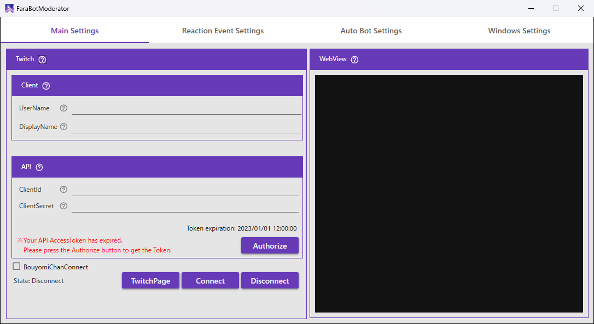
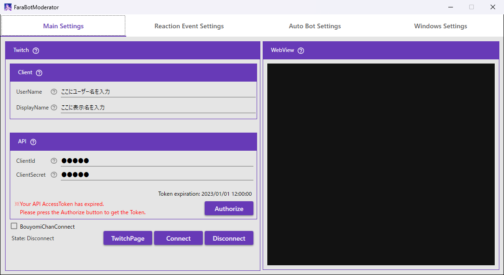

# 導入の手順

インストールから、Twitch チャットにつなぐところまでの手順です。初めて使うときに、上から順に進めてください。

## 動作環境

| 項目 | 必須・任意 | 使う場面 |
|---|---|---|
| Windows 10 / 11（x64） | **必須** | アプリを動かす |
| WebView2 ランタイム（Microsoft Edge ベース） | **必須** | Twitch のログイン画面などを、アプリの中に表示する。インストーラーが必要に応じて入れます |

## 用意するアカウント・ソフト

| 項目 | 必須・任意 | 使う場面 |
|---|---|---|
| Twitch アカウント | **必須** | Twitch に接続する（ログインして、アプリを許可します） |
| Twitch Developer アプリケーション | **必須** | Twitch に接続する（`ClientId` と `ClientSecret` の発行元。このページの手順で作ります） |
| DeepL API キー | 任意 | チャットを翻訳する |
| 棒読みちゃん | 任意 | チャットを読み上げる |

「任意」の項目は、その機能を使わないなら用意しなくてかまいません（空のままでも、アプリは動きます）。

## 1. インストールして起動する

1. [GitHub Releases の最新版](https://github.com/fara1991/fara-bot-moderator/releases/latest) から `FaraBotModerator_Setup.exe` をダウンロードして実行します。
2. インストール後、デスクトップのショートカットまたはインストール先の `FaraBotModerator.exe` を実行します。

起動すると、「Main Settings」タブが表示されます。

## 2. Twitch Developer アプリケーションを作る

1. [Twitch Developer Console](https://dev.twitch.tv/console) にアクセスします。
2. 「アプリケーションを登録」をクリックします。
3. 次の内容を入力します。
   - **名前**: 任意のアプリ名
   - **OAuth リダイレクト URL**: `http://localhost:3000`（ポート番号は設定に合わせる）
   - **カテゴリ**: 「Chat Bot」
4. 作成後に発行される「Client ID」と「Client Secret」を控えます。

## 3. Twitch と連携する

「Main Settings」タブで設定します。

1. 「Client」の `UserName` に、Twitch にログインするときのユーザー名（URL の末尾の名前）を入れます。
2. 「Client」の `DisplayName` に、Twitch で表示される名前を入れます。
3. 「API」の `ClientId` と `ClientSecret` に、手順 2 で控えた値を入れます。
4. 「**Authorize**」ボタンをクリックします。
5. 右側の WebView に Twitch のログイン画面が出るので、Twitch アカウントでログインして、アプリを許可します。
6. 認証が終わると、`Token expiration` に有効期限が表示されます。

> [!NOTE]
> 認可のときに Twitch が求める権限は 7 つです。`chat:read`・`chat:edit`・`channel:read:redemptions`・`bits:read`・`moderator:read:followers`・`user:read:follows`・`moderator:manage:shoutouts` です。取得した情報は、アプリの画面への表示・読み上げ・ログに使います。

## 4. Twitch チャットにつなぐ

| ボタン | 内容 |
|---|---|
| `TwitchPage` | WebView に Twitch チャンネルページを表示する |
| `Connect` | Twitch チャットに接続する |
| `Disconnect` | Twitch チャットから切断する |

接続の状態は「**State: Connect / Disconnect**」で確認できます。

## 5. 必要に応じて設定する

| やりたいこと | 見るページ |
|---|---|
| チャットを翻訳したい | [settings.md の「翻訳」](settings.md#翻訳) |
| 読み上げたい（棒読みちゃん） | [settings.md の「棒読みちゃん連携」](settings.md#棒読みちゃん連携) |
| フォローやレイドに自動で返信したい | [settings.md の「リアクションイベント」](settings.md#リアクションイベント) |
| 定期的にメッセージを送りたい | [settings.md の「タイマー」](settings.md#タイマー) |
| ポケモンのコマンドを使いたい | [pokemon.md](pokemon.md) |
| Beat Saber のコマンドを使いたい | [beatsaber.md](beatsaber.md) |

うまくいかないときは、[困ったとき](troubleshooting.md) と [よくある質問](faq.md) を見てください。
