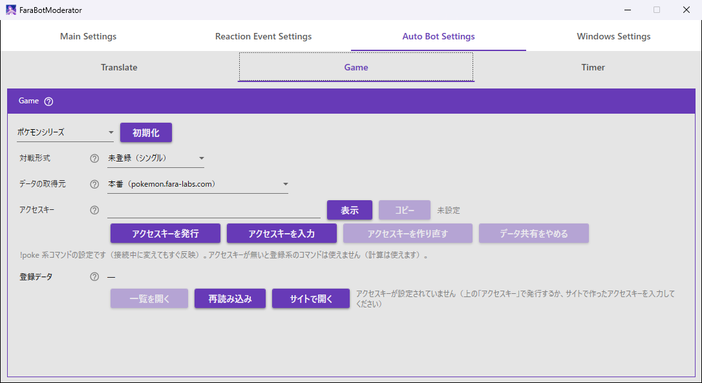

# ポケモンのコマンド（!poke）

チャットで、ポケモンの登録・ダメージ計算・素早さ比較・相手チームの管理ができます。結果はボットが返信します。コマンドの一覧だけ見たいときは [早見表](commands.md) を見てください。

## 目次

- [最初に知っておくこと](#最初に知っておくこと)
- [設定画面](#設定画面)
- [データ共有（アクセスキー）](#データ共有アクセスキー)
- [接頭辞（データセット）](#接頭辞データセット)
- [育成ポケモン](#育成ポケモン配信者モデレーターのみ)
- [自分チーム](#自分チーム配信者モデレーターのみ)
- [対戦（dmg・scan・faster・end）](#対戦dmgscanfasterend)
- [相手チーム（-r）と履歴（-h）](#相手チーム-rと履歴-h)
- [注意](#注意)
- [コマンドの例](#コマンドの例)

## 最初に知っておくこと

- `!poke help` で、使えるコマンドの一覧が返ります。
- 登録・更新・削除・使用チームの変更は、**配信者本人とモデレーターのみ**行えます。ダメージ計算（`dmg`）と素早さ比較（`faster`）は誰でも使えます。
- 登録系のコマンドには**アクセスキー**が必要です（[データ共有](#データ共有アクセスキー)）。
- `!poke` 系のコマンドは、翻訳・読み上げの対象外です。

> [!NOTE]
> ポケモンのデータは、初回のみインターネット接続が必要です（1 日キャッシュされます）。登録データはサイトのクラウドに保存するため、登録系のコマンドを使うたびにインターネット接続が必要です。

## 設定画面

「Auto Bot Settings」の「Game」タブで、ゲームの選択欄から「ポケモンシリーズ」を選ぶと、次の設定が出ます。接続中に変えても、すぐ反映されます。

| 項目 | 内容 |
|---|---|
| 対戦形式 | 形式を書かなかったコマンドが使う形式。「未登録（シングル）」「シングル」「ダブル」から選ぶ。チャットの `format` と同じ設定 |
| データの取得元 | ポケモン・技・持ち物などのデータの取得元。ふだんは「本番」、公開前の確認には「開発用」 |
| アクセスキー | データ共有のためのキー（[下の節](#データ共有アクセスキー)） |
| 登録データ | 登録したポケモンとチームの要約 |



「対戦形式」が使われる場面は、次のとおりです。
- ダメージ計算とダブルの全体技の補正
- チームの追加・使用・一覧の対象

設定は `secrets.json` に保存されます（対戦形式は `pokemon.battleFormat`、データの取得元は `pokemon.dataSource`）。未登録は `null` で、シングルとして動きます。

### 登録データの表示

- 登録データはサイトのクラウドに保存され、アクセスキーで読み書きします。**この PC には保存しません**。
- アクセスキーの欄の右に、データ共有の状態（「データ共有中」「サイトから読み込めません」「未設定」など）が出ます。アクセスキーが無いときは、「アクセスキーが設定されていません」と出ます。
- 「登録データ」の欄には、登録のあるゲームごとに「ポケモンチャンピオンズ: 登録 15 体・チーム 3（使用中: シングル1・ダブル2）」のような 1 行の要約が出ます。
- 登録データは**見るだけ**です。登録・削除・使用チームの変更は、チャットのコマンドか、サイトの「育成ポケモン」「自分チーム」ページで行います。

| ボタン | 内容 |
|---|---|
| 一覧を開く | 登録したポケモンとチームの一覧を、別のウィンドウで開く。ウィンドウの大きさは自由に変えられ、上の選択欄でゲームを切り替える。開いているときにもう一度押すと、そのウィンドウが前に出る。メインのウィンドウを閉じると一緒に閉じる |
| 再読み込み | 最新の内容にする（「Game」タブでも一覧のウィンドウでも、両方が更新される）。読み込めなかったときは、理由が表示される |
| サイトで開く | データの取得元のサイトの「育成ポケモン」ページをブラウザで開く（本番の場合: <https://pokemon.fara-labs.com/my-pokemon>） |

特性・持ち物の名前は、「データの取得元」のデータで表示します。データを取得できないときは ID で表示します。

## データ共有（アクセスキー）

登録したポケモン・チームは、サイト（「データの取得元」で選んだ本番または開発用のサイト）のクラウドに保存されます。サイトの「育成ポケモン」「自分チーム」ページと同じデータを読み書きします。どのデータを使うかは、**アクセスキー**（43 文字の英数字・`-`・`_`）で決まります。

「Auto Bot Settings」の「Game」タブで「ポケモンシリーズ」を選び、「アクセスキー」の欄で操作します。

| ボタン | 内容 |
|---|---|
| 表示 / 隠す | アクセスキーを表示する・伏せ字に戻す（ふだんは伏せ字のままにしてください） |
| コピー | 使用中のアクセスキーをクリップボードにコピー |
| アクセスキーを発行 | 新しいアクセスキーを作り、データ共有を始める（クラウドの置き場は空から始まる）。サイトの「データ共有」ページでこのアクセスキーを貼り付け、「アクセスキーを入力して共有」を押すと、サイトと同じデータを使える |
| アクセスキーを入力 | サイトで作ったアクセスキー（サイトの「データ共有を始める」で作ったもの）を「アクセスキー」の欄に貼り付けてから押す。クラウドから読めることを確かめてから使う（正しくない・作り直されたアクセスキーのときはエラーを表示し、今のアクセスキーのままにする） |
| アクセスキーを作り直す | アクセスキーが漏れたときなどに使う。登録データを新しいアクセスキーに移し、古いアクセスキーは使えなくする。**サイトや他の PC でも、新しいアクセスキーを入力し直してください** |
| データ共有をやめる | このボットでアクセスキーを使うのをやめる。クラウドのデータは残り、サイトはそのまま使える（登録系のコマンドは使えなくなる） |

> [!WARNING]
> **アクセスキーはパスワードと同じ扱いです**。知っている人は誰でも登録データを読み書きできるので、配信画面に映したり、チャットに貼ったりしないでください。漏れたときは「アクセスキーを作り直す」を使います。

### 保存と取り扱い

- アクセスキーは `secrets.json` の `pokemon.syncKey` に保存されます。発行・入力・作り直し・停止の直後に保存され、接続中でもすぐ反映されます。
- 「データの取得元」を切り替えると、登録データのクラウドも切り替わります。本番と開発用のデータは別々で、同じアクセスキーでも中身は共有されません。
- 「アクセスキーを作り直す」は、新しいアクセスキーを `secrets.json` に保存できてから切り替えます。保存できなかったときは、今のアクセスキーのままです。もう一度試してください。
- 作り直しの途中で古いアクセスキーへ登録が書かれたときは、その登録も新しいアクセスキーへ写し直してから、古いアクセスキーを消します。それでも消せないときは、「古いアクセスキーは残っています」と表示します。その場合、古いアクセスキーに書かれた内容は、新しいアクセスキーに入っていないかもしれません。古いアクセスキーは使わないでください。
- サイトでアクセスキーを作り直したときは、ボットに「このアクセスキーは作り直されたため使えません。新しいアクセスキーを設定してください」と出ます。新しいアクセスキーを「アクセスキーを入力」で設定し直してください。
- アクセスキーが無いと、登録系のコマンドは「失敗しました: アクセスキーが設定されていません（Auto Bot Settings > Game で設定してください）」と返ります。

## 接頭辞（データセット）

コマンドの先頭に付ける接頭辞で、どのゲームのデータを使うかが決まります。

| 接頭辞 | データセット |
|---|---|
| `!pokech` | ポケモンチャンピオンズ |
| `!pokesv` | スカーレット・バイオレット |
| `!pokess` | ソード・シールド |
| `!poke` | チャンピオンズ扱い |

## 育成ポケモン（配信者・モデレーターのみ）

育成済みのポケモンを登録します。

| コマンド | 内容 |
|---|---|
| `add -m 名前 H A B C D S 性格 [特性]` | 育成済みポケモンを登録する（ID が振られる） |
| `set -m 登録IDか名前 [振り方] [性格] [特性]` | 登録済みの育成ポケモンを更新する |
| `ls -m [名前]` | 一覧 |
| `detail -m ID` | 詳細 |
| `rm -m ID` | 削除 |

- 振り方は、`4 32 0 0 0 30` のように 6 つ並べるか、書いた能力だけ（`H32B32C2` や `H32 B32`）で指定します。書いていない能力は 0 になります。性格は必須です。
- `set -m` で振り方（ポイント）を書いたときは、振り方全体を置き換えます（書いていない能力は 0）。性格・特性は、書いたものだけ更新します。
- 同じポケモンを別の育成で複数登録でき、それぞれ別の登録 ID で表示されます。
- 短い形の `-m` / `-t` が主です（例: `!pokech use -t 1`）。長い形の `--my` / `--team` も同じ意味で使えます（例: `!pokech add --my ガブリアス 4 32 0 0 0 30 ようき`）。全角スペースで区切っても使えます。
- 返信に出る性格は、性格名ではなく、上がる・下がる能力で表示されます（例: ひかえめ = `C↑A↓`）。まじめ・てれやなどの補正のない性格は表示されません。登録するときの性格は、性格名で指定します。
- チャンピオンズの努力値はポイント制です（各 0〜32、合計 66）。SV・剣盾は従来の努力値です（各 0〜252、合計 510）。

## 自分チーム（配信者・モデレーターのみ）

登録したポケモンでチームを作り、使用するチームを決めます。

| コマンド | 内容 |
|---|---|
| `add -t 番号 ID [持ち物] [-f 形式]` | チームに登録済みポケモンを追加する。そのチームがなければ作る |
| `use -t 番号 [-f 形式]` | 使用チームを切り替える（使用チームは形式ごとに 1 つ） |
| `unuse -t [-f 形式]` | 使用チームを解除する |
| `ls -t [-f 形式]` | チーム一覧。形式を書かないと、シングルとダブルの両方を並べる |
| `detail -t 番号 [-f 形式]` | チームの詳細 |
| `rm -t 番号 [名前] [-f 形式]` | チームの削除（0 体になったチームは自動で削除）。`rm -t 番号 #3` のように、登録 ID でも指定できる |
| `set -t 番号 形式 [新番号]` | チームを別の形式へ移す |
| `format` | 登録している形式を確認する |
| `format set 形式` / `format clear` | 形式を登録する / 解除する（配信者・モデレーターのみ） |

### 形式（シングル・ダブル）

- チームの番号は、**シングルとダブルで別々**です。「シングルのチーム1」と「ダブルのチーム1」を両方持てて、使用チームも形式ごとに 1 つです。返信には、「ダブルのチーム1」のように形式が付きます。
- 形式は `-f シングル` / `-f ダブル` で指定します（`--format` も同じ。`single` / `double` / `しんぐる` / `だぶる` でも可）。例: `add -t 1 1 こだわりスカーフ -f ダブル`、`use -t 1 --format double`
- **形式を書かなかったときは、登録している形式のチーム**が対象です（登録していなければシングル）。登録は `format set シングル` / `format set ダブル`、解除は `format clear`（解除するとシングルに戻る）、確認は `format` です。「Auto Bot Settings > Game」の「対戦形式」も同じ設定で、画面で変えてもチャットで変えても同じ状態になります（「未登録（シングル）」が `format clear` に当たります）。
- `add -t` の末尾の `シングル` / `ダブル` も当面は読み取りますが、`-f` を使ってください。

### チームを別の形式へ移す

`set -t 番号 形式 [新番号]` は、チームを別の形式へ**移します**（例: `set -t 2 ダブル`、`set -t 2 ダブル 5`）。

- 移す先に同じ番号のチームがあるとエラーになります。番号は自動では変わらないので、`set -t 2 ダブル 5` のように空いている番号を付けてください。
- 移す前の形式は、移す先と反対の形式です。同じ形式の中で番号を付け替えるときは `-f` を付けます。
- 使用中のチームを移すと、移す前の形式の使用チームは解除されます。移した先の使用チームは、自動では設定されません。

### 使用チームと計算

- 使用チームのポケモンは、登録した努力値・性格・特性・持ち物で計算されます。
- `dmg` / `scan` / `faster` は、計算の形式（`-f`、`dmg` に書いたダブル、なければ登録している形式）の**使用チーム**を使います。
- その形式に使用チームがなければ、もう一方の形式のチームは使わず、登録済みポケモンの既定の構成で計算します。

> [!NOTE]
> チームの番号が形式ごとに分かれる前に登録したチームは、**すべてシングルのチーム**として移行されています（以前ダブルにしていたチームも、使用チームだったチームもシングルとして扱います）。使用チームもシングルの使用チームとして引き継がれ、**ダブルの使用チームは「なし」から始まります**。
>
> ボットの対戦形式がシングル（または未登録）の配信者は、これまでと何も変わりません。対戦形式をダブルにしている配信者は、更新直後は使用チームがないため、ダブルで使っていたチームを `set -t 番号 ダブル`（同じ番号があるときは新番号も付けて）でダブルへ移し、`use -t 番号 -f ダブル` で使用チームにしてください。

## 対戦（dmg・scan・faster・end）

`dmg` と `faster` は誰でも使えます。`scan` は相手チームを登録するため、配信者・モデレーターのみ使えます。`end` も、配信者・モデレーターのみです。

| コマンド | 内容 |
|---|---|
| `dmg 攻撃 技±ランク 防御 [オプション]` | ダメージ計算（通常のダメージ。急所はオプション `急所`） |
| `scan 攻撃 技±ランク 相手 受けたダメージ[%]` | 受けた（与えた）ダメージから、相手の防御の振り方と性格補正を推定し、相手チームに反映する |
| `faster 自分 相手` | 素早さ比較（どちらが先に動くか） |
| `end [メモ]` | 試合を終える。対戦中の相手を全員履歴に移し、対戦中の相手を空にする。メモを付けると履歴に残る |

### 攻撃側（自分）の指定

- 攻撃側（自分）の構成は、計算の形式（`-f シングル|ダブル`、`dmg` に書いたダブル、なければ登録している形式）の使用チームを使います。
- 同じポケモンを別の育成で複数登録しているときは、攻撃側を `#登録ID`（`#3` や `3`）で指定します。名前だけで指定すると、どれを使うか警告して、登録 ID つきの一覧を返します。使用チームにその 1 体だけがいれば、警告なしでその 1 体を使います。
- `set -m` も、複数いるときは一覧を返して、登録 ID の指定を案内します。

### 攻撃側・防御側の前置き

項目の前に、攻撃側・防御側のどちらかを付けて指定できます。全角の「：」も使えます。

| 側 | 前置き |
|---|---|
| 攻撃側 | `攻:` `攻撃:` `こうげき:` `A:` `C:` `atk:` |
| 防御側 | `防:` `防御:` `ぼうぎょ:` `B:` `D:` `def:` |

- 英字は側の指定だけで、能力は技の分類で決まります。
- 持ち物名は、前置きがなくても防御側（対戦中の相手）に付きます。
- 攻撃側は登録済みのポケモンなので、持ち物は育成ポケモン・自分チームの登録で決まります。持ち物名を攻撃側に付けることはできません（書くと警告して、反映しません）。

### dmg

`dmg` のオプション例: 努力値、性格、持ち物、特性、`急所`、`やけど`、`どく`、`まひ`、天候、フィールド（`サイコフィールド` など。略称も可）、`壁`

- 返信は 2 行です。1 行目は構成（`攻撃側(努力値 性格 持ち物 特性) 技 → 防御側(努力値 性格 持ち物)`）、2 行目は `結果 …` で、ダメージ（ダメージの幅と確定数）を出します。
- 確定数には、回復きのみ・たべのこし・半減きのみ・グラスフィールドの回復が反映されます。
- **連続技**（2〜5 回当たる技。トリプルアクセルなど）は、当たった回数ごとの合計を `結果 1回目: … | 2回目: … | 3回目: …` のように並べます（スキルリンクは 5 回だけ）。
- **おやこあい**は、`結果 1回目: … | 2回目: …` のように、1 回目と 2 回目（合計）を並べます。
- **急所**は、オプション `急所` を付けたときだけ計算します。付けると、すべて急所のダメージになり、`結果（急所）` と出ます。付けないときは、急所のダメージは出しません。
- 性格は、性格名のほか、上がる・下がる能力で `B↑A↓` のように指定できます（ひかえめ = `C↑A↓`）。

### scan

`scan` で分かった相手の振り方は、範囲のまま相手チームとして覚え（クラウドに保存）、そのあとの `dmg` の防御側に使います。

- 返信は、1 行目が入力した内容、2 行目以降が結果です。2 行目は `結果 ○○ D実数値: ○〜○, 持ち物: ○○`（持ち物が不明なら `持ち物: 不明`。末尾に `相手チームに登録` / `絞り込み(○回目)` が付きます）、3 行目は `D上昇補正: ○〜○pt | D補正無し: ○〜○pt | D下降補正: ○〜○pt` です。
- 相手の性格が分かっているときは、その補正の範囲だけを出し、結果の行に `(D↑)` のように出します。
- `scan` で `防:たべのこし` のように持ち物を書くと、その持ち物で推定して、確定情報として相手チームに保存します（`set -r カイリュー たべのこし` でも保存できます）。メガシンカ後の姿は、メガストーンで確定です。
- 覚えている相手への `dmg` の返信は、技が使う防御の文字（B/D）を付けた 2 行になります（範囲のとき。「B（特殊技なら D）最小想定」「最大想定」の順）。
- `dmg` で振り方を指定したときは、指定した数値で計算します。分かっている振り方の防御（B/D）と技が使う防御が違うときは、その振り方は使わず、既定で計算します。
- 防御側（対戦中の相手）の持ち物は、書いたもの・相手チームに保存した持ち物・メガストーンだけを使います。不明なら持ち物なしとして計算し、表示にも出しません（使用率の持ち物は入れません）。
- 相手チームの性格は、上がる能力だけ（`D↑`）・下がる能力だけ（`A↓`）でも書けます。書いていない方は補わず、「不明」のまま覚えます（あとでもう片方が分かったら、書き足すと性格にまとまります）。
- 育成ポケモンの性格は、片方だけ書くと、もう片方を使わない攻撃能力にして決めます。

### 計算に必要な登録

- 計算系（`dmg` / `faster`）は、**登録済みのポケモンだけ**使えます（`dmg` の攻撃側と `faster` の育成ポケモン。防御側・相手は登録不要）。`scan` の攻撃側も登録済みのポケモンです。
- 登録されていないと、「…は登録されていません」と返ります。登録データを読めないとき（アクセスキーが無い・クラウドに接続できない）は、登録系と同じく「失敗しました: …」と返ります。

## 相手チーム（-r）と履歴（-h）

対戦中の相手を登録します（同じポケモンは 1 体、6 体まで）。名前だけ登録しておき、分かった部分から埋めていきます。クラウドに保存されるので、サイトの「相手チーム」ページ（`/my-rival`）でも同じ操作ができます。

| コマンド | 内容 |
|---|---|
| `add -r 名前… [振り方] [性格] [特性]` | 対戦中の相手を登録する。名前だけでもよく、複数の名前をまとめて登録できる（選出画面の 6 体など） |
| `set -r 名前 [振り方] [性格] [特性] [技 …] [持ち物]` | 登録済みの相手を更新する（まだなら登録） |
| `ls -r` | 対戦中の相手の一覧 |
| `detail -r 名前` | 1 体の詳細（推定の根拠つき） |
| `rm -r 名前` | 登録ミスなどの取り消し（履歴には残さない） |
| `clear -r` | 対戦中の相手の登録を全員解除する（履歴には残さない） |
| `ls -h [名前]` | 試合の履歴（新しい順。名前を付けると、そのポケモンの履歴） |
| `detail -h ID` | 1 試合の詳細 |
| `rm -h ID` | 履歴の削除 |

- `add -r` の振り方は、`H32 D10` か 6 つの数字（`H A B C D S`）で、性格は名前か `B↑A↓` で指定します。同じポケモンをもう一度指定すると更新します。対戦中の数と合わせて 6 体を超える指定はエラーになり、1 体も登録されません。
- `set -r` で持ち物（確定したもの）を書くと保存され、`dmg`・`scan`・履歴に使います。相手が使った技（その相手が覚える技）を書くと、4 つまで覚えて履歴に残ります（書いた分だけ足します）。
- `set -r` のポイント・性格・特性は、書いたものだけ更新し、書いていない能力は今のままです（`scan` の推定も消えません）。
- `set -r メガリザードンX …` のように姿を変えると、同じ相手のまま姿だけ変わります（ポイント・性格・推定はそのまま）。
- 履歴は、アクセスキーごと・ゲームごとに 10,000 件までです。上限に達すると `end` が失敗するので、古い履歴を `rm -h` で消してください。

### 選出と試合の終了

- 試合に出てきた相手は、`set -r 名前 選出`（`add -r` でも可）で選出と印を付けます。
- 試合を終える（`end`）と、選出した相手に印が付いたまま、対戦中の相手が全員（選出しなかった相手も）履歴に移ります。選出した相手・見えた技・ポイント・性格・特性・推定も一緒に残ります。
- 履歴の `detail -h ID` で、選出・技・ポイントを見返せます。
- 相手は試合ごとに変わるので、試合が終わったら `end [メモ]` で履歴に移します。

### 相手チームと dmg

登録した相手は、`dmg` の防御側に使われます。
- 1 つに決まっていれば、その振り方で 1 行です。
- 範囲のときは、「B（特殊技なら D）最小想定」「最大想定」の 2 行です。
- 分かっていない部分（HP・防御）は、全振りで計算します。

## 注意

- 登録・更新・削除・使用チームの変更（`add -m` / `set -m` / `rm -m` / `add -t` / `set -t` / `rm -t` / `use -t` / `unuse -t` / `format set` / `format clear`）と、相手チーム・履歴の `-r` / `-h` の変更、`scan` は、**配信者本人とモデレーターのみ**行えます。
- 視聴者が実行すると、「…は配信者・モデレーターのみ行えます」と返ります。`scan` は、「scan は相手チームを登録するため、配信者・モデレーターのみ使えます」と返ります。閲覧・計算系は誰でも使えます。
- 相手の登録・更新・削除・試合の終了（`add -r` / `set -r` / `scan` / `rm -r` / `clear -r` / `end` / `rm -h`）も、配信者本人とモデレーターのみです。一覧・詳細（`ls` / `detail`）は誰でも使えます。
- 計算系（`dmg` / `faster`）は、同じユーザーの連続実行を 5 秒間無視します（登録系と `scan` には掛かりません）。
- 登録データはサイトのクラウドに保存されます（この PC には保存しません）。詳しくは [データ共有（アクセスキー）](#データ共有アクセスキー) を見てください。
- ポケモンのデータの取得元は、「Auto Bot Settings > Game」の「データの取得元」で切り替えます（本番または開発用。1 日キャッシュ）。
- 計算ロジック: [fara-pokemon-battle-assistant](https://github.com/fara1991/fara-pokemon-battle-assistant)（ブラウザ版: <https://pokemon.fara-labs.com/chat-commands>）

## コマンドの例

```
!poke help
!pokech add -m ガブリアス 4 32 0 0 0 30 ようき
!pokech add -t 1 1 こだわりスカーフ
!pokech use -t 1
!pokech add -t 1 1 こだわりスカーフ -f ダブル
!pokech use -t 1 -f ダブル
!pokech ls -t
!pokech set -t 2 ダブル 5
!pokech format set ダブル
!pokech dmg ガブリアス ドラゴンクロー+1 リザードン
!pokesv faster ガブリアス ハバタクカミ
```
